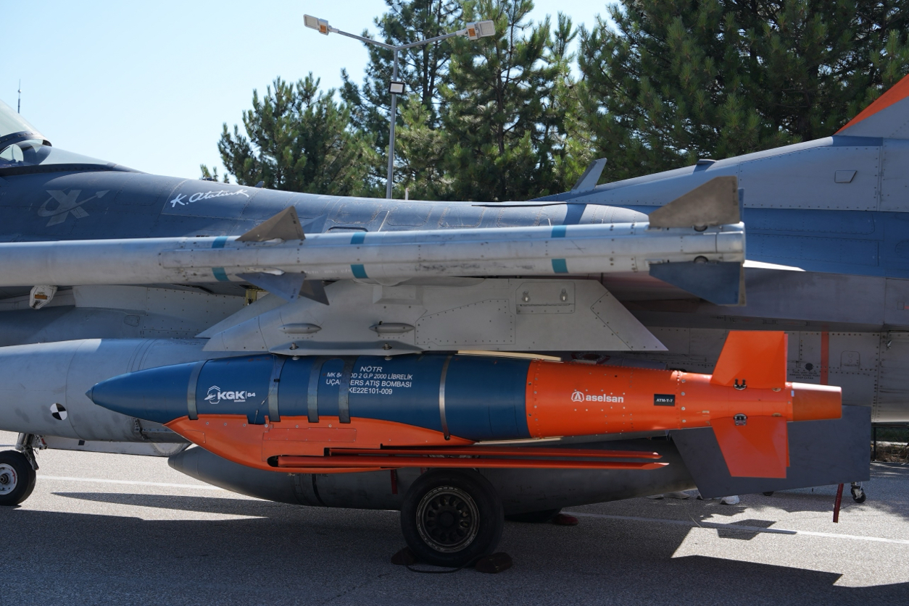

# ASELSAN KGK-84 göreve hazır: F-16'dan ilk kalifikasyon menzil atışı tamamlandı

**Özet:** ASELSAN'ın geliştirdiği KGK-84 Kanatlı Güdüm Kiti, Sinop Atış Alanı'nda F-16 platformundan ilk kalifikasyon menzil atışını başarıyla gerçekleştirdi. F-16'dan atıldığında 100 km menzile ulaşabilen kit, savaş uçaklarının düşman hava savunma sistemlerinin menzili dışından saldırı yapmasına olanak tanıyor.

*KGK-84 kitli 2000 librelik bomba, F-16 üzerinde.*

*Kaynak: ASELSAN basın bülteni. Yazıdaki teknik özellikler ve menzil bilgisi şirketin kendi beyanıdır; bağımsız olarak doğrulanmamıştır.*

## Sinop'ta ilk kalifikasyon atışı

ASELSAN KGK-84, uzun menzilden önceden belirlenmiş yol noktalarını yüksek hassasiyetle takip edebilme kabiliyeti ve dünyadaki muadillerinden ayrışan ileri teknolojileriyle göreve hazırlanıyor. Sinop Atış Alanı'nda gerçekleştirilen test faaliyetinde F-16'dan ilk kalifikasyon menzil atışı başarıyla tamamlandı.

## Açılır kanat sistemiyle süzülüş

KGK-84'ün en kritik bileşenlerinden biri açılır kanat sistemi. Bu sayede mühimmat serbest düşüş yerine süzülerek uçuyor. F-16'dan atıldığında 100 km menzile ulaşabilen "at-unut" yeteneği, savaş uçaklarına düşman hava savunma sistemlerinin menzili dışından saldırı imkânı veriyor.

## Ne işe yarıyor?

KGK-84, 2000 lb sınıfındaki MK-84, MK-84-T, NEB ve NEB-T serbest düşüm bombalarını yüksek güvenilirlikli ve uzun menzilli hava-yer akıllı mühimmatlarına dönüştüren kanatlı güdüm kiti. Kendi tümleşik ataletsel seyrüsefer sistemini ve GPS karıştırmasına dayanıklı anten ile küresel konumlandırma sistemini içeriyor. Her türlü hava koşulunda çalışarak, uzun menzilden bırakıldığında düşman sahasına girmeden yüksek vuruş hassasiyetinde görev yapabiliyor.

## Öne çıkan özellikler

- Yüksek vuruş hassasiyeti ve yüksek tahribat gücü
- Açılır kanat bütünü ile uzun menzil
- Her türlü hava şartında kullanılabilme
- Gece/gündüz şartlarında görev yapabilme
- Fırsat hedeflerine taarruz
- Bütünleşik ANS/KKS tabanlı güdüm kiti
- CRPA antijam anteni ile GNSS karıştırmasına karşı dayanıklılık
- Yol noktası takibi yapabilme
- Seçilebilir vuruş açısı
- MIL-STD-1760 uyumluluğu
